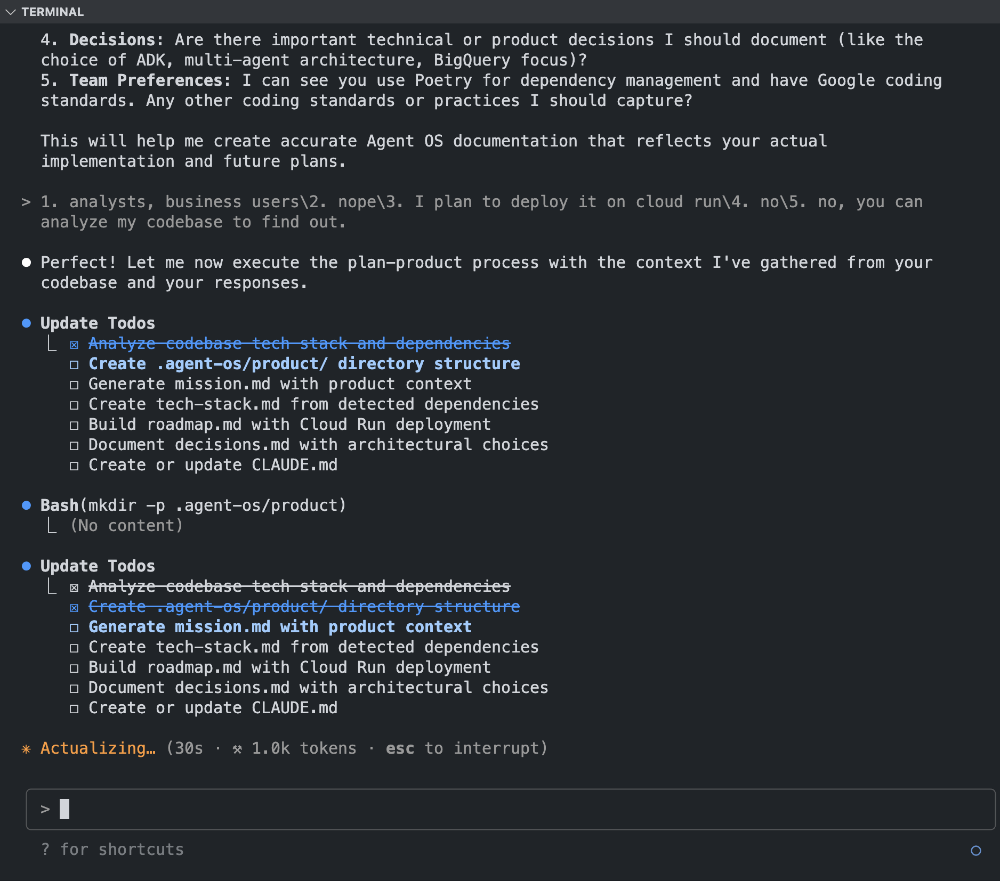
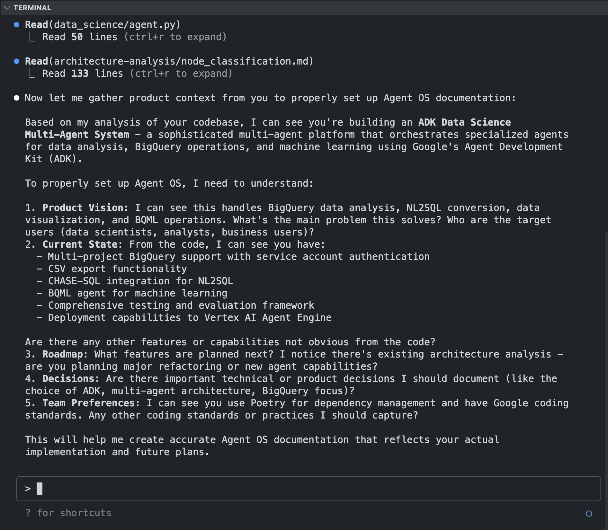

# Agent OS Adaptive

agent-os-adaptive is my optimized version of agent-os, designed to help AI agents be more "responsible" when collaborating with engineers.

It's an AI development framework that automatically adapts its approach based on code impact analysis. This is a fork of Agent OS with added leaf/core node classification to create optimal development workflows.

## 🧠 Core Innovation

**Dependency-Based Intelligent Classification**: Automatically analyzes actual code dependencies to determine optimal development approach:

- **🔍 Dependency Analysis** → Scans codebase and builds Mermaid dependency graphs  
- **📊 Rule-Based Classification** → `aoa-classify` decides core / business / leaf from versioned rules: sensitive areas (auth, payments, PII, migrations, public API…), runtime cycles, and a risk score (impact × cost of failure ÷ detectability)
- **🎯 File-Level Precision** → Classifies individual files/modules (computed by `tools/aoa_graph`), not just features
- **🔄 Mixed Approach Support** → Handles specs spanning multiple node types with phase-based implementation

### Classification Results:
- **Leaf Node** → Autonomous AI development with E2E testing focus
- **Core Node** → Careful oversight with comprehensive testing layers  
- **Business Logic** → Standard TDD with integration testing
- **Mixed Approach** → Selective strategies per component type

Inspired by Erik Schultz's talk on [Vibe Coding](https://youtu.be/fHWFF_pnqDk?si=lzHZFO4TNMKGP7As), enhanced with data-driven dependency analysis.


## 🚀 Quick Start

### Prerequisites

- **Claude Code CLI** or **Cursor IDE** with Claude integration
- **Git** (recommended)

### Step 1: Clone Agent OS Adaptive

```bash
cd ~
git clone https://github.com/fredrick84823/agent-os-adaptive.git
```

### Step 2: Tool-Specific Setup

> The instructions reference files via `@~/agent-os-adaptive/...`, so keep the clone at `~/agent-os-adaptive` (Step 1). There is no hosted setup script; copy the files directly.

**Claude Code CLI**
```bash
# Instructions as custom slash commands (/plan-product, /analyze-product, /analyze-node-classes, /create-spec, /execute-tasks)
mkdir -p ~/.claude/commands ~/.claude/agents
cp ~/agent-os-adaptive/instructions/*.md ~/.claude/commands/

# Subagents (core-node-agent, leaf-node-agent, and utility agents)
cp ~/agent-os-adaptive/subagents/*.md ~/.claude/agents/
```

**Cursor IDE** (run inside your project)
```bash
mkdir -p .cursor/rules
for f in ~/agent-os-adaptive/instructions/*.md; do
  cp "$f" ".cursor/rules/$(basename "${f%.md}").mdc"
done
```

- Each instruction becomes a `.mdc` rule (e.g. `@plan-product`, `@execute-tasks`); their frontmatter already uses Cursor's `description` / `globs` / `alwaysApply` fields.

### Step 2b: Install the Dependency-Graph and Classification Tools (`aoa-graph`, `aoa-classify`)

`/analyze-node-classes` no longer asks the model to estimate in/out-degrees. It runs `tools/aoa_graph`, a small Python CLI that parses **TypeScript / JavaScript and Python** with [tree-sitter](https://tree-sitter.github.io/) and writes deterministic numbers (same commit → byte-identical output).

Requires [uv](https://docs.astral.sh/uv/getting-started/installation/), Python ≥ 3.10 (tested on 3.10 and 3.13; uv downloads one if missing) and `git` (for churn / bug-fix history). Dependencies are pinned in `pyproject.toml` / `uv.lock`.

```bash
curl -LsSf https://astral.sh/uv/install.sh | sh   # if uv is not installed yet
uv sync --project ~/agent-os-adaptive              # creates ~/agent-os-adaptive/.venv from uv.lock
```

Run it from your project root (the instruction does this for you):

```bash
uv run --project ~/agent-os-adaptive aoa-graph .
# aoa-graph: 83 nodes, 180 edges, 2 cycles (22 nodes; runtime-only: 2 cycles), 2 unresolved, ... in 0.12s → ./agent-os-adaptive/architecture-analysis
```

| Output (in `agent-os-adaptive/architecture-analysis/`) | Contents |
|---|---|
| `graph.json` | File-level nodes (`id`, `language`, `is_test`, `loc`, Python `module`), internal edges with import `kinds`, external packages per file |
| `metrics.json` | Per node: `fan_in`, `fan_out`, `test_fan_in`, `blast_radius` (transitive dependents), `in_cycle` / `scc_id` (Tarjan), `in_runtime_cycle` (ignoring type-only imports), `churn`, `churn_lines`, `bugfix_count`, `co_change` |
| `unresolved.json` | Dynamic / unresolvable imports, files with parse errors — the part the model interprets |

Then classify (also done by the instruction):

```bash
uv run --project ~/agent-os-adaptive aoa-classify .
# aoa-classify: 83 nodes (24 ranked, 48 tests, 11 examples) → core 10, business 12, leaf 61; high_risk 7; overrides applied 0, pending 0 → ./agent-os-adaptive/architecture-analysis/nodes.json
```

| Output / input | Contents |
|---|---|
| `nodes.json` | Per file: `class` (core / business / leaf), `computed_class`, triggered `rules` and human-readable `reasons`, `risk_score`, `percentile`, `risk_level`, `high_risk` (runtime cycle), score `factors` |
| `overrides.jsonl` (optional, you or the model write it) | Class overrides with reasons. Stricter ones apply automatically; looser ones need `"approved_by": "<human>"` |
| `.aoa.toml` (optional, your project root) | Repo-level rules: `core_paths` (CODEOWNERS-style globs), extra sensitive keywords / paths / packages, `not_sensitive` exemptions, thresholds, weights, coverage file |

Optional coverage input: `--coverage coverage.json` (coverage.py `coverage json`) or `lcov.info`. Rules, defaults and the score formula: [`tools/aoa_graph/README.md#aoa-classify`](tools/aoa_graph/README.md#aoa-classify).

How good are the classes? `aoa-eval` scores the default rules against hand-labelled files in pinned open-source repos (flask, httpx, zod, django): Cohen's kappa, per-class precision / recall, an asymmetric cost (calling a core file leaf is the worst error and fails the run), determinism and churn across adjacent commits. Latest numbers: [`eval/results/report.md`](eval/results/report.md); method and caveats (the labels are an agent's first pass and still need human review): [`eval/README.md`](eval/README.md).

Useful options: `--since-days 180` (history window, anchored at the HEAD commit time), `--bugfix-pattern REGEX`, `--exclude 'docs/**'`, `--py-root DIR`, `--lang ts|py`, `--out DIR`, `--no-git`. Full output format and resolution rules: [`tools/aoa_graph/README.md`](tools/aoa_graph/README.md).

### Step 3: Projects Setup

#### 🆕 For New Projects (0 → 1)

1. **Create your project**
   ```bash
   mkdir my-awesome-project
   cd my-awesome-project
   git init
   ```

2. **Initialize with Agent OS**

   **Claude Code:**
   ```bash
   /plan-product
   I want to build a SaaS tool for tracking customer feedback with AI-powered insights
   ```

   **Cursor:**
   ```bash
   @plan-product
   I want to build a SaaS tool for tracking customer feedback with AI-powered insights
   ```

#### 🔄 For Existing Projects

1. **Navigate to your project**
   ```bash
   cd your-existing-project
   ```

2. **Analyze and install Agent OS**

   **Claude Code:**
   ```bash
   # agent will analyze product -> plan product -> scan codebase to generate docs
   /analyze-product
   Please analyze my codebase and set up Agent OS documentation
   ```

   **Cursor:**
   ```bash
   # agent will analyze product -> plan product -> scan codebase to generate docs
   @analyze-product
   Please analyze my codebase and set up Agent OS documentation
   ```

   **Example**:

   

### Step 4: Interactive Setup

The AI will guide you through:
- 📝 **Product Mission**: Define your vision and target users
- 🛠️ **Tech Stack**: Detect or configure your technology choices  
- 📋 **Roadmap**: Create development phases and feature priorities
- 🏗️ **Architecture Analysis**: Map dependencies (existing projects only)

   **Example**:

   

### Step 5: Start Building Features

**Claude Code:**
```bash
# Plan a new feature
/create-spec
I want to add user authentication with OAuth and email verification

# Execute development tasks  
/execute-tasks
Let's implement the user registration feature
```

**Cursor:**
```bash
# Plan a new feature
@create-spec
I want to add user authentication with OAuth and email verification

# Execute development tasks
@execute-tasks
Let's implement the user registration feature
```

### Step 6: What Gets Generated

Agent OS creates a complete project structure:

```bash
your-project/
├── agent-os-adaptive/
│   ├── product/                    # Product documentation
│   │   ├── mission.md             # Vision and goals
│   │   ├── roadmap.md             # Development phases
│   │   ├── tech-stack.md          # Technology choices
│   │   └── decisions.md           # Decision history
│   ├── architecture-analysis/     # Dependency analysis (existing projects)
│   │   ├── graph.json / metrics.json / unresolved.json  # Computed by aoa-graph
│   │   ├── nodes.json / overrides.jsonl  # Classes from aoa-classify / override log
│   │   ├── dependency_map.mermaid # Visual dependency graph
│   │   └── node_classification.md# Component analysis
│   └── specs/YYYY-MM-DD-feature/  # Feature specifications
│       ├── spec.md                # Requirements
│       ├── tasks.md               # Implementation tasks
│       └── sub-specs/             # Technical details
└── CLAUDE.md                      # Project-specific instructions
```

### 💡 Example Results

See a complete example of Agent OS in action or just see examples folder in this repo:
**[ADK Data Science Agent](https://github.com/fredrick84823/adk-data-science-agent/tree/main/python/agents/data-science)** - A real project built using Agent OS Adaptive showing the complete structure and documentation.

## 🎯 Detail Feature Explanation

### 🔍 Intelligent Analysis Process

The system now performs comprehensive dependency analysis to make precise classifications:

1. **Codebase Scanning** - `tools/aoa_graph` parses TS/JS and Python files with tree-sitter (file/module granularity)
2. **Dependency Mapping** - Writes `graph.json`; the Mermaid map is rendered from it
3. **Impact Analysis** - `metrics.json` computes fan-in/out, "blast radius", cycles, git churn and bug-fix counts
4. **Component Classification** - `aoa-classify` applies deterministic rules and writes `nodes.json`; the model explains the result and may only propose overrides

### 📊 Classification Categories

Classes are decided by `aoa-classify` in this order (same inputs → same classes):

1. **Tests and example / docs / benchmark code** → Leaf, not ranked.
2. **Hard rules → Core**: `core_paths` from your `.aoa.toml`; sensitive areas (auth, crypto, secrets, payments / billing, PII / compliance, irreversible deletes, DB schema / migrations, public API and package entrypoints) matched by path, keyword, or imported package; membership in a **runtime cycle** (also flagged `high_risk`).
3. **Risk score** `impact × cost_of_failure ÷ detectability`, ranked by percentile within the repo: top 10% → Core (the next 5 points also Core — when in doubt, stricter); low scores with ≤ 2 non-test dependents → Leaf; the rest → Business.
4. **Overrides**: stricter ones apply automatically; looser ones need a human's approval.

Out-degree is no longer a criterion, and the old "low out-degree" vs "bidirectional dependencies" contradiction is gone: cycles are now a hard rule of their own.

#### Leaf Nodes (Autonomous Development)
✅ **Low risk score, (almost) nothing depends on it**
- Feature-specific components, UI with one-way data flow, report generators and exporters
- Can be removed without breaking other features
- Test files and example code

**Rule**: percentile < 35 and ≤ 2 non-test files depend on it (directly or transitively), no hard rule hit
**Approach**: E2E-focused testing, rapid implementation, acceptable technical debt

#### Core Nodes (Careful Oversight)
⚠️ **Sensitive, cyclic, or top-risk**
- Auth, crypto, secrets, payments, PII, migrations, public API surfaces
- Members of runtime dependency cycles (high risk)
- Files whose failure reaches many others, change often, and have a bug-fix history, with few tests watching them

**Rule**: any hard rule, or risk percentile ≥ 85
**Approach**: Comprehensive layer testing, architecture-first, multiple implementation modes

#### Business Logic Nodes (Standard Development)
🔄 **Everything in between**
- Orchestrates between core and leaf nodes
- Contains domain-specific logic
- Controllers and service layers

**Rule**: not core, not leaf
**Approach**: Standard TDD with integration testing focus

#### Mixed Approach (Component-Selective)
🎯 **Multiple Node Types in Single Spec**
- Different components require different approaches
- Phase-based implementation (core → business → leaf)
- Risk-based development prioritization

**Approach**: Selective strategies per component type

## 🔄 Enhanced Adaptive Workflow

### 1. Dependency-Based Code Analysis
- **Codebase Scanning**: `tools/aoa_graph` parses every TS/JS and Python file into a file-level dependency graph
- **Dependency Mapping**: Creates visual Mermaid graphs showing component relationships
- **Impact Calculation**: Measures "blast radius" of proposed changes
- **Component Classification**: Generates detailed classification tables with metrics

### 2. Comprehensive Architecture Analysis & Node Classification
The agent generates a detailed `node_classification.md` file that provides a complete breakdown of your codebase's architecture. This file is crucial for making informed decisions about development strategies.

**Example `node_classification.md`** (excerpt; numbers from running the tools on pallets/flask @ `49943b5a`):

```markdown
# Node Classification Analysis

> Analysis Method: Computed metrics (aoa-graph 0.1.0) + rule-based classes (aoa-classify, rules 2026.11-2 / repo none) + model explanation
> Classes: core 10, business 12, leaf 61 (ranked 24, tests 48, examples 11); high_risk 7; overrides applied 0, pending 0

## Component Classifications

### Core Nodes (Require Careful Oversight)

| File | Rules | Score (pct) | Fan-in | Blast radius | Cycle | Churn | Bug-fix | Risk Level | Justification |
|------|-------|-------------|--------|--------------|-------|-------|---------|------------|---------------|
| src/flask/app.py | score_top | 7.111222 (p97.92) | 6 | 69 | scc-2 | 6 | 4 | HIGH | The Flask application object; the highest risk score (4 bug-fix commits in the window). It sits in runtime cycle scc-2 but is not one of its hubs |
| src/flask/sessions.py | sensitive:auth, sensitive:crypto | 1.805456 (p39.58) | 6 | 69 | - | 1 | 0 | MEDIUM | Signs session cookies with itsdangerous; core by hard rule even though its score is mid-range |

### Leaf Nodes (Autonomous Development Candidates)

| File | Rules | Score (pct) | Fan-in | Blast radius | Cycle | Churn | Bug-fix | Risk Level | Justification |
|------|-------|-------------|--------|--------------|-------|-------|---------|------------|---------------|
| src/flask/views.py | score_low | 0.455964 (p2.08) | 4 | 4 | - | 1 | 0 | LOW | Class-based view helpers; no non-test file depends on it (all 4 dependents are tests) |

## Development Recommendations

### For Core Node Changes
- **Approach:** Traditional careful development with comprehensive testing
- **Testing:** Full integration test suite, performance testing

### For Leaf Node Changes
- **Approach:** Autonomous development with E2E focus
- **Testing:** End-to-end user scenarios, acceptance testing
```

This analysis also includes:
- **Visual Dependency Map**: A link to the `dependency_map.mermaid` graph.
- **Risk Assessment**: Quantified impact levels for each component.
- **Project-Level Persistence**: The analysis is stored at the project level for reuse across all feature specifications.

### 3. Intelligent Agent Delegation
- **Main Agent Analysis**: Reads architecture analysis and classifies task components
- **Smart Delegation**: Routes to specialized subagents based on node types
- **Unified Decision Making**: Centralized classification logic with transparent reasoning

### 4. Specialized Agent Execution
- **Core Node Agent** (`@subagents/core-node-agent.md`): Careful oversight with comprehensive testing
- **Leaf Node Agent** (`@subagents/leaf-node-agent.md`): Autonomous rapid implementation
- **Mixed Approach**: Phase-based delegation to appropriate agents per component

### 5. Mode Selection (Core Nodes Only)
- **Full Agent**: AI handles everything with review points
- **Agent Planning**: AI plans, user implements  
- **User-Led**: User implements, AI validates

### 6. Component-Selective Execution
Main agent delegates different components to appropriate specialized agents based on dependency analysis

## 📁 Overall Folder Structure

```
# Cloned repository structure (~/agent-os-adaptive/):
agent-os-adaptive/
├── instructions/           # Core workflow instructions
│   ├── plan-product.md    # Product initialization
│   ├── analyze-product.md # Existing codebase analysis
│   ├── analyze-node-classes.md # (NEW) Standalone, reusable node classification
│   ├── create-spec.md     # Feature specification (uses analysis)
│   └── execute-tasks.md   # Task execution (adaptive)
├── tools/aoa_graph/       # Dependency-graph CLI (tree-sitter; TS/JS + Python)
├── tests/                 # pytest suite + small TS / Python fixture repos
├── pyproject.toml         # aoa-graph deps (pinned) + dev group; uv.lock locks them
├── standards/             # Development standards
│   ├── tech-stack.md      # Technology preferences
│   ├── code-style.md      # Coding conventions
│   └── best-practices.md  # Workflow guidelines
└── subagents/             # Specialized agent configurations
    ├── leaf-node-agent.md # Autonomous implementation
    ├── core-node-agent.md # Oversight-heavy approach
    └── ...                # Additional utility agents

# Generated during project initialization (in your project):
agent-os-adaptive/
├── product/                       # Product-level documentation
│   ├── mission.md                # Product vision and goals
│   ├── roadmap.md                # Development phases
│   ├── tech-stack.md             # Technology choices
│   └── decisions.md              # Decision history
├── architecture-analysis/         # Project-wide analysis (NEW)
│   ├── graph.json                # Computed dependency graph (aoa-graph)
│   ├── metrics.json              # Computed per-file metrics (aoa-graph)
│   ├── unresolved.json           # Imports the tool could not resolve
│   ├── nodes.json                # Rule-based classes (aoa-classify)
│   ├── overrides.jsonl           # Class overrides (stricter auto, looser need approval)
│   ├── dependency_map.mermaid    # Visual dependency graph
│   └── node_classification.md    # Component analysis table
└── specs/YYYY-MM-DD-spec-name/   # Individual feature specs
    ├── spec.md                   # Spec requirements
    ├── tasks.md                  # Implementation tasks
    └── sub-specs/                # Spec-specific technical docs
        ├── technical-spec.md     # Technical requirements
        ├── api-spec.md           # API specifications (if needed)
        ├── database-schema.md    # Database changes (if needed)
        └── tests.md              # Testing specifications
```

## 🤝 Contributing

This framework is designed to evolve with your development patterns. Contributions welcome for:
- Additional node classification criteria
- New specialized subagents
- Improved workflow automation
- New idea of workflow

Before opening a PR, run:

```bash
python3 scripts/lint-instructions.py  # frontmatter, absolute paths, @~/agent-os-adaptive/ references
uv run pytest                         # aoa-graph resolution, cycles, blast radius, git metrics; aoa-classify rules, scores, overrides; determinism
```

## 📚 Related

- [Original Agent OS](https://github.com/buildermethods/agent-os) by Brian Casel
- [Builder Methods](https://buildermethods.com/agent-os) by Brian Casel
- [Vibe Coding Talk](https://youtu.be/fHWFF_pnqDk?si=lzHZFO4TNMKGP7As) by Erik Schultz